# SplitSmart — AI bill splitter for Android

Photograph a restaurant receipt, let on-device OCR and Gemini turn it into line items, split it paise-exactly between
friends, and settle up with one-tap UPI links. Offline-first (Room), Kotlin, Jetpack Compose, Hilt.

> Build status: all 7 features built, then polished and verified end to end on an Android 17 emulator (Pixel 7 AVD): gallery
> import → ML Kit OCR → Gemini (`gemini-3.1-flash-lite`, 2.4-2.7 s in the app) through the pinned client → review → split → UPI
> link opened in a UPI app. Baseline Profile generation and macrobenchmarks are still "not run".

## Features
| # | Feature | Status |
|---|---|---|
| 1 | Groups and members (Room), offline-first, bill history | done |
| 2 | Receipt scanning: CameraX capture + gallery import → ML Kit on-device text recognition | done (device-only parts compile-only, see below) |
| 3 | LLM extraction: Gemini over OkHttp with SSL pinning, strict JSON, validate + repair, editable review, regex fallback | done |
| 4 | Split calculator: equal / by item / by share, proportional tax + tip, paise-exact remainders, who-owes-whom simplification | done |
| 5 | One-tap UPI settle-up links (`upi://pay` per debt) + share as text / QR | done |
| 6 | Firebase Crashlytics + Analytics: scan / parse success, splits created, settle-up taps, custom keys, non-fatals | done |
| 7 | Performance: Baseline Profile + Macrobenchmark modules, LeakCanary, StrictMode, work off the main thread | done (device runs not executed: no device) |

## Screenshots
Taken on the emulator during the end-to-end run (light theme; two dark-theme shots at the end).

| Home (your balance) | Group | Add from camera | Recognised on device |
|---|---|---|---|
| 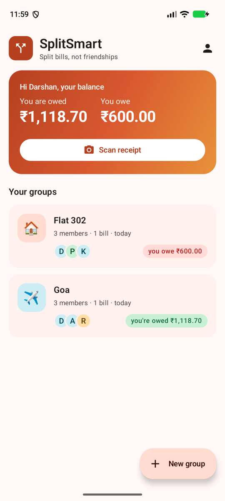 | 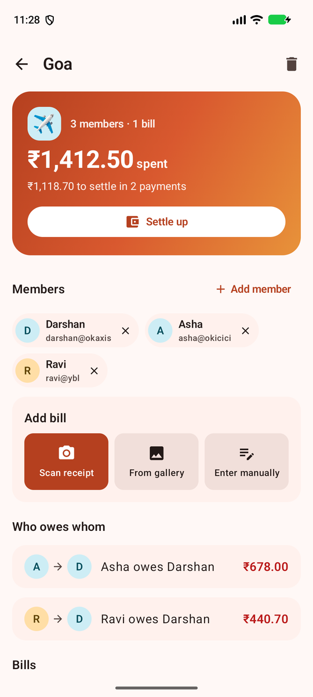 | 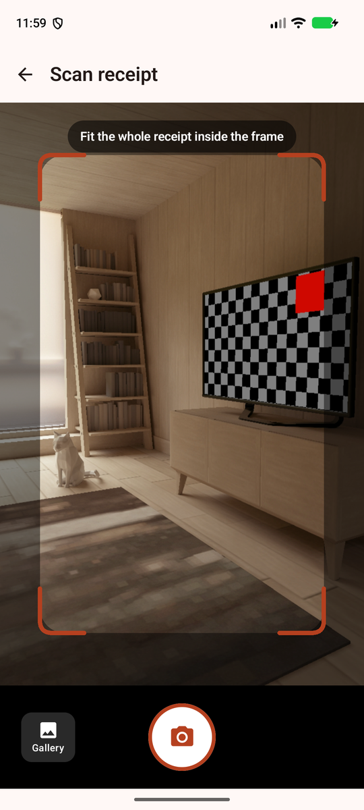 | 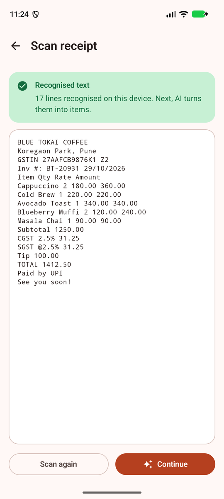 |
| **AI is refining (on-device draft)** | **AI extraction** | **Totals check** | **Discount → mismatch warning** |
| 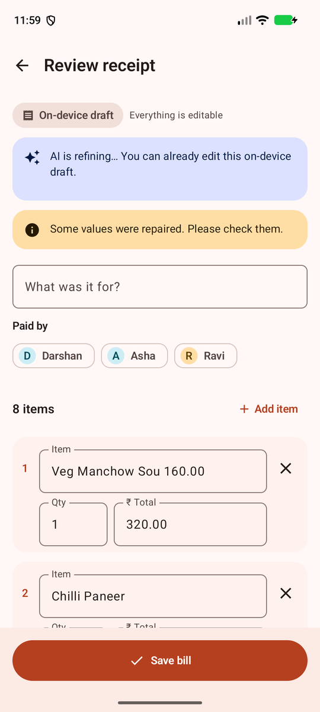 | 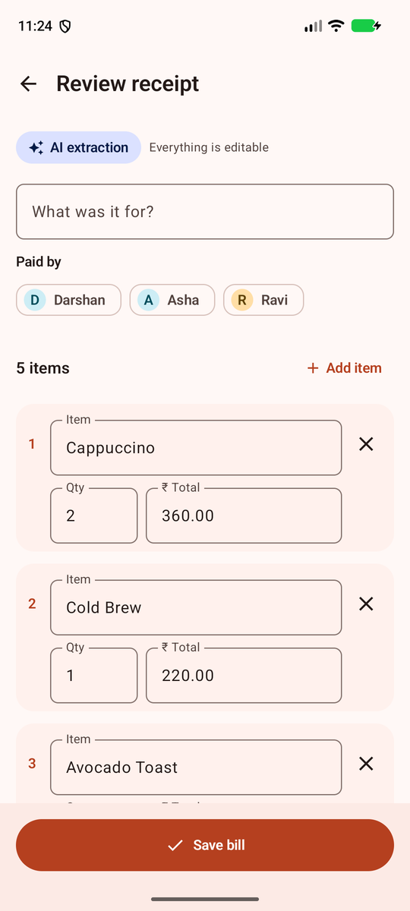 | 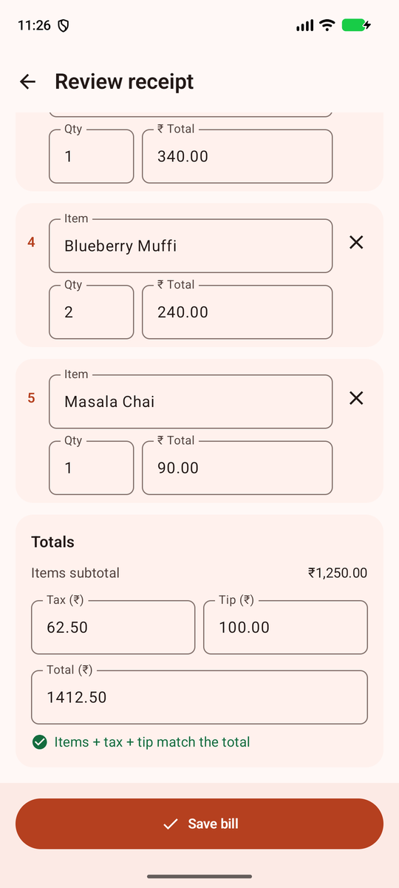 | 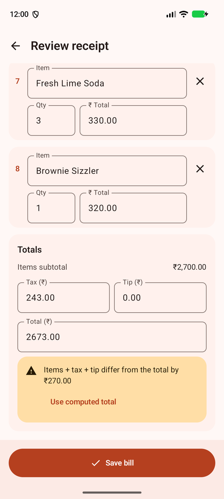 |
| **Offline fallback** | **Bill** | **Split by item** | **Paise-exact result** |
| 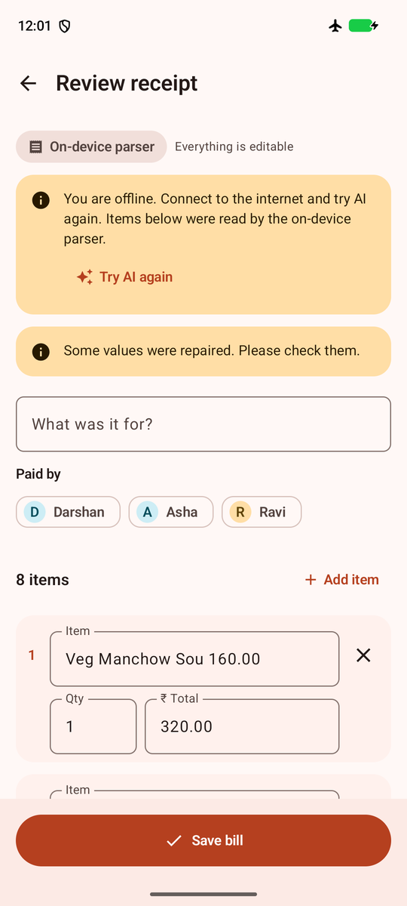 | 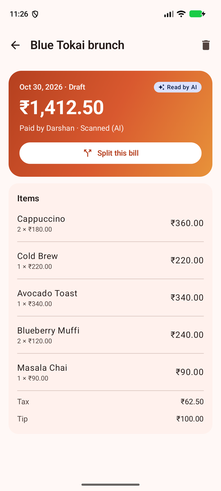 | 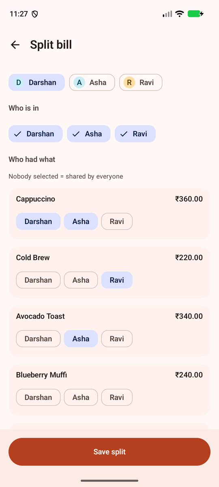 | 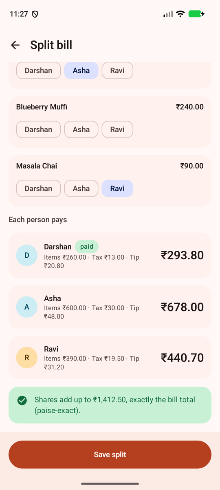 |
| **Settle up** | **QR** | **UPI app opened, prefilled** | **Empty state** |
| 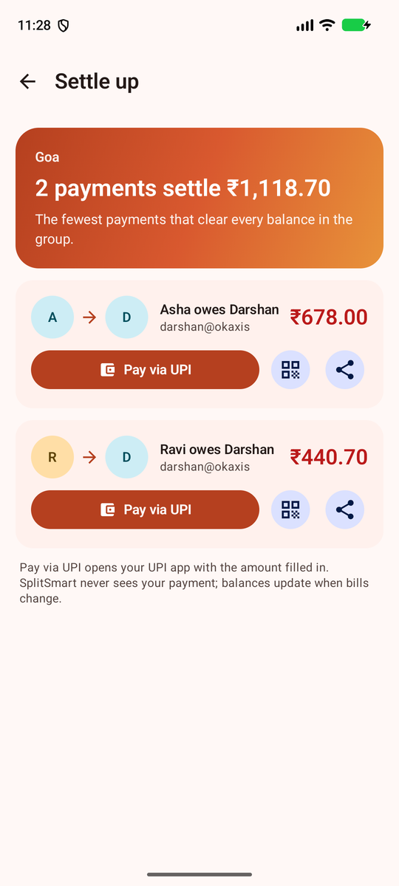 | 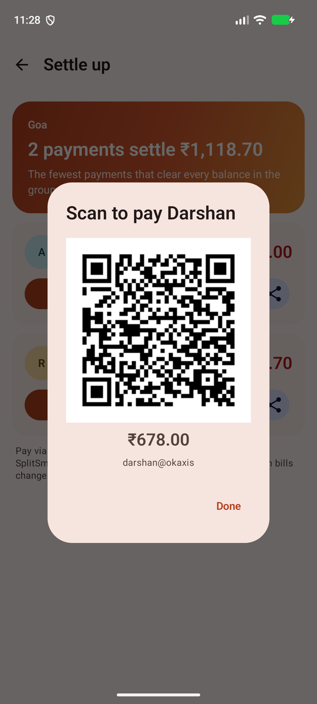 | 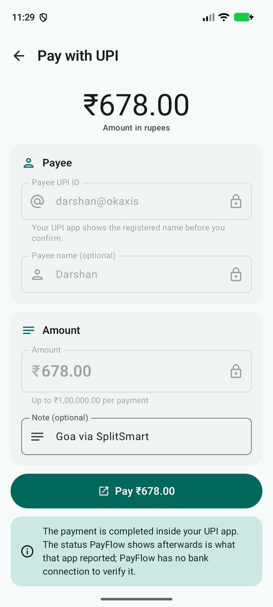 | 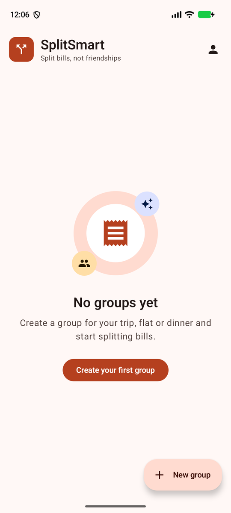 |
| **Which group? (home scan)** | **Dark: home** | **Dark: split** | |
| 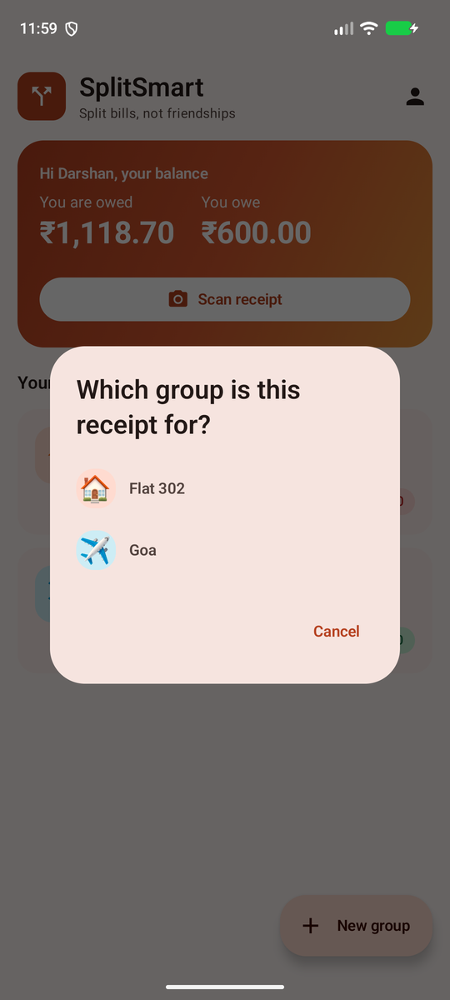 | 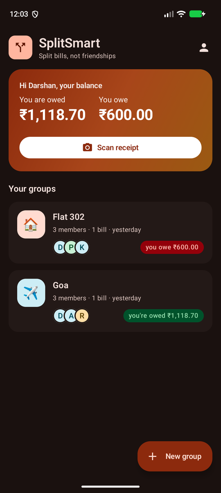 | 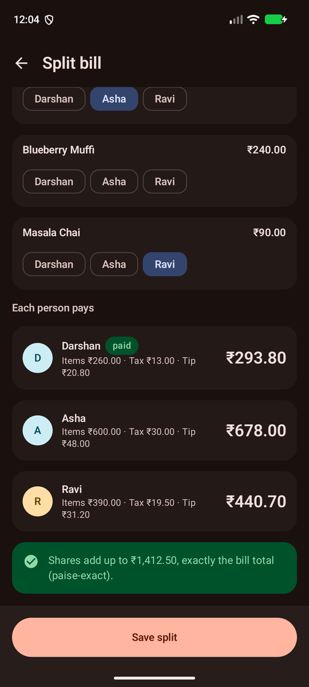 | |

The "UPI app" on the emulator is [PayFlow](https://github.com/Darshan-05032003/PayFlow) (it registers for `upi://pay`); on a phone the
same link offers GPay / PhonePe / Paytm / BHIM.

## Design
Coral primary with an indigo accent reserved for anything AI-made and a saffron accent for warnings; money direction has its own
green (owed to you) / red (you owe) pair. Hand-tuned light and dark Material 3 schemes (dynamic colour off), a coral → saffron hero
card for headline numbers, emoji group tiles, initial avatars, an adaptive launcher icon, and loading / empty / error / content states
with icons on every screen. "Your name" (stored only on the phone) lets the home screen show what you owe and are owed across groups.

## Tech stack
Kotlin 2.4 · Jetpack Compose + Material 3 · Navigation Compose (type-safe routes) · Hilt (KSP) · Room 2.8 (exported schemas) ·
Kotlin coroutines + Flow · kotlinx.serialization · OkHttp 5 · CameraX · ML Kit Text Recognition · ZXing · Firebase (Analytics, Crashlytics) ·
JUnit 4, Truth, MockK, Turbine, Robolectric, Compose UI test, MockWebServer, Kover · AGP 9.5 (built-in Kotlin), Gradle 9.6, compileSdk 37, minSdk 26.

## Architecture
MVVM + Clean Architecture: `ui` (Compose + ViewModels, one `StateFlow<UiState>` each) → `domain` (models, use cases, pure
parsers and split math) ← `data` (Room, OCR, LLM client, UPI, analytics). Money is always `Long` paise. Dispatchers and
`java.time.Clock` are injected. Every external SDK sits behind an interface with a fake for JVM tests.

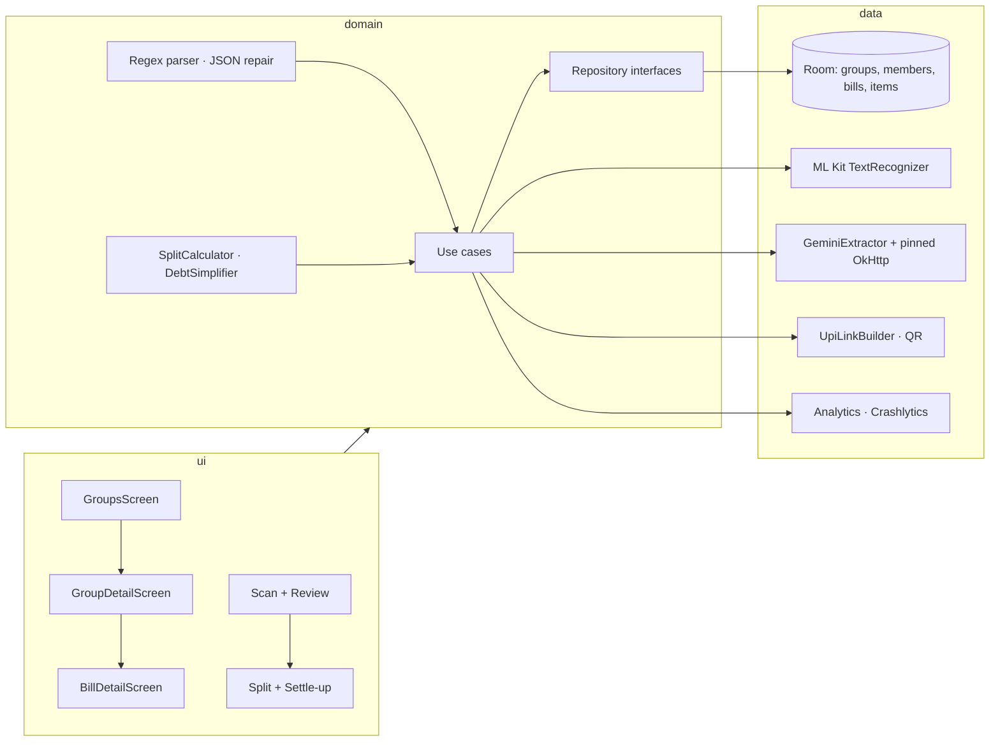

## How to run
1. Clone and open in Android Studio (AGP 9.5, JDK 17 toolchain).
2. `local.properties`:
   ```properties
   sdk.dir=/path/to/Android/Sdk
   LLM_API_KEY=your-gemini-api-key        # optional; without it the app shows a "key missing" state and uses the on-device parser
   ```
   The key is read into `BuildConfig.LLM_API_KEY` at build time (quotes/whitespace stripped) and never logged.
   Like any `BuildConfig` constant it can be extracted from the APK; for a store release move the call behind your own backend.
3. Firebase (optional): put `app/google-services.json` in place. The Google Services and Crashlytics Gradle plugins are
   applied only when that file exists, so a clean clone without Firebase still builds.
4. `./gradlew assembleDebug` and install `app/build/outputs/apk/debug/app-debug.apk`.

## AI extraction
- **Model:** `gemini-3.1-flash-lite` (fallback list `gemini-flash-lite-latest` → `gemini-3.5-flash-lite`; on a 404 the next model is
  tried once and the one that answered is cached in DataStore). Request: `thinkingConfig.thinkingLevel = "minimal"`, `temperature 0`,
  `responseMimeType: application/json` + a response schema for `{items:[{name,qty,unitPaise,totalPaise}],taxPaise,tipPaise,totalPaise}`
  (integers in paise), `maxOutputTokens 8192`, a compact prompt. The key travels in the `x-goog-api-key` header, never in the URL.
- **Measured latency** (same 7-item receipt, 2026-10-30, one call each; key never logged):

  | Model | Thinking | Result | Latency |
  |---|---|---|---|
  | `gemini-3.1-flash-lite` | minimal | HTTP 200, exact | **3.1 s** (curl) · **1.2 s** (`realApiTest`, small receipt) · **2.4 s / 2.7 s** tap-to-result in the app on the emulator (5- and 7-item receipts; the 8-item one took 3-7 s, during which the on-device draft was shown) |
  | `gemini-flash-lite-latest` | minimal | HTTP 200, exact | 3.5 s |
  | `gemini-3.5-flash-lite` | minimal | HTTP 200, exact | 4.0 s |
  | `gemini-3.8-flash` | low (minimal rejected) | client timeout | > 120 s (147 s at default thinking before) |

- **Never blocked on the network:** if the AI has not answered after 400 ms the review screen shows the on-device parser's draft
  ("AI is refining…", editable); the AI result replaces it, or is offered ("Use AI result" / "Keep mine") if you already edited.
  Timeouts: 10 s connect / 30 s read / 45 s per call.
- **Clear AI state:** "AI extraction" / "On-device parser" / "On-device draft" label on the review screen, an AI badge on bills,
  and specific copy for a missing key (how to set `LLM_API_KEY`), a rejected key (401/403), rate limiting (with the server's
  `Retry-After`), timeouts, being offline and a certificate-pin failure. Everything stays editable.
- **OCR layout:** ML Kit returns a receipt's name and amount columns as separate blocks; `OcrLayout` rebuilds printed rows from the
  line boxes (deskewed by the median line angle), which was essential on the real images (see DECISIONS).

## LLM safety and SSL pinning
- The answer is treated as untrusted: `JsonRepair` (fences, prose, trailing commas, smart quotes, truncation) → tolerant parser →
  `ReceiptValidator` (drops negative/absurd amounts, fixes `qty × unit`, caps 200 items, derives or flags the total). Every repair
  is shown as a warning on the editable review screen.
- Any failure (no key, 4xx, 401, 429, 5xx, timeout, malformed) falls back to the on-device `RegexReceiptParser`; the review screen
  says why and offers "Try AI again". Retries: full-jitter exponential backoff (0.5 s → 8 s, 4 attempts), `Retry-After` honoured and capped.
- **Certificate pinning** (`GeminiPins`, OkHttp `CertificatePinner`): Google serves two chains for `generativelanguage.googleapis.com`
  (ECDSA leaf → `WE2` → `GTS Root R4`; RSA leaf → `WR2` → `GTS Root R1`), and leaf certificates rotate every few weeks, so the app pins the
  intermediates (primary) and roots (backup) of both chains:

  | Role | Certificate | SPKI SHA-256 pin |
  |---|---|---|
  | primary | GTS WE2 (intermediate, ECDSA chain) | `sha256/vh78KSg1Ry4NaqGDV10w/cTb9VH3BQUZoCWNa93W/EY=` |
  | primary | GTS WR2 (intermediate, RSA chain) | `sha256/YPtHaftLw6/0vnc2BnNKGF54xiCA28WFcccjkA4ypCM=` |
  | backup | GTS Root R4 (expires 2028-01-28) | `sha256/mEflZT5enoR1FuXLgYYGqnVEoZvmf9c2bVBpiOjYQ0c=` |
  | backup | GTS Root R1 (expires 2028-01-28) | `sha256/hxqRlPTu1bMS/0DITB1SSu0vd4u/8l8TjPgfaAp63Gc=` |

  Fetched on 2026-10-30 with:
  ```bash
  openssl s_client -connect generativelanguage.googleapis.com:443 -servername generativelanguage.googleapis.com -showcerts </dev/null
  # for every certificate in the printed chain (save each PEM block to a file):
  openssl x509 -in cert.pem -pubkey -noout | openssl pkey -pubin -outform der | openssl dgst -sha256 -binary | openssl enc -base64
  # the RSA chain appears when the client only offers RSA signature algorithms:
  openssl s_client -connect generativelanguage.googleapis.com:443 -servername generativelanguage.googleapis.com -sigalgs "RSA+SHA256:RSA-PSS+SHA256" -showcerts </dev/null
  # roots cross-checked against https://pki.goog/repo/certs/gtsr1.pem and gtsr4.pem
  ```
  **Rotation risk:** if Google moves to new intermediates *and* new roots at once, every pin fails and the LLM path degrades to the
  on-device parser (the app keeps working). Refresh the pins before 2028 or after any Google PKI announcement. The pinner is injectable
  (`LlmHttpClient.create(pinner)`), and `PinningTest` proves that a wrong pin is rejected on a real TLS handshake.
- **Real call:** `./gradlew realApiTest` makes exactly one request with your key through the production pinned client and
  production timeouts. Result on 2026-10-31: `gemini-3.1-flash-lite`, HTTP 200, 2 items, total 21,000 paise, 0 warnings, **1,178 ms**.
- **Pins verified on the device:** the in-app calls on the emulator went through `GeminiPins.pinner()` and succeeded; the live chains
  were re-fetched with openssl on 2026-10-31 and still match all four pins (WE2, WR2, GTS Root R4, GTS Root R1).

## Split calculator
- Three modes: **equally**, **by item** (tap who had what; untouched items are shared by everyone) and **by share / percentage** (any non-negative weights).
- Tax and tip are allocated proportionally to each person's items (by item) or by the same weights; an **adjustment** line carries discounts / round-off so people pay exactly the printed total.
- Paise are apportioned with the **largest-remainder method** (`LargestRemainder`), so every split sums exactly to the bill and nobody is more than one paisa from their ideal share; property-tested on thousands of random bills and on 1,000 people × 10,000 items.
- **Who owes whom:** every split bill with a known payer is netted per group and simplified greedily (largest debtor pays largest creditor, at most n − 1 transfers).

## UPI settle-up
- Every simplified debt gets a `upi://pay?pa=&pn=&am=&cu=INR&tn=` link (amount in rupees with two decimals from paise, all values RFC 3986 percent-encoded). **Pay via UPI** opens the system chooser of installed UPI apps, **Share** sends the text with the link, **QR** shows a zxing QR code the payer can scan from another phone; a payee without a UPI ID can get one added inline.
- The app never marks a debt paid from the UPI app's return (a client cannot verify it); balances change when bills change.
- **This opens real UPI apps and real money moves.** Test with tiny amounts to your own VPA.

## Firebase Crashlytics + Analytics
- Behind `AnalyticsTracker` / `CrashReporter` interfaces; real Firebase is bound only when `app/google-services.json` was present at build time, otherwise no-ops (a clean clone builds and runs without Firebase).
- Events: `scan_success` / `scan_failure` (source, error), `llm_parse_success` (item/warning counts, text length), `llm_parse_failure` (failure kind, `fallback_used`), `split_created` (mode, member and item counts), `settle_up_tap` (method). Parameters are enums, counts and booleans only.
- Non-fatals with custom keys (`scan_error`, `llm_failure`, `text_length`, `group_size`, `item_count`) for defects such as a recogniser crash or a Gemini 5xx; expected outcomes (no text, no API key) are metrics only.
- Privacy: `AnalyticsPolicy` rejects keys containing name/vpa/amount/phone-like words and values with `@` or long digit runs; crash log lines are scrubbed. Nothing with a person's name or an amount ever leaves the device as telemetry.
- Verified on the emulator: with `adb shell setprop debug.firebase.analytics.app com.darshan.splitsmart` and `log.tag.FA-SVC VERBOSE`, logcat showed `llm_parse_success` (`item_count=5, warning_count=0, text_length=350`), `llm_parse_failure` (`failure=offline, fallback_used=1`) and `settle_up_tap` (`method=upi, payee_has_id=1`): counts and enums only, no names or amounts.

## Performance
| Item | Where | Status |
|---|---|---|
| Baseline Profile generator | `baselineprofile/` (`BaselineProfileGenerator`: start → create group → open → scan rationale), `profileinstaller` in the app | **not run: no device.** Generate with `./gradlew :app:generateBaselineProfile`; the profile lands in `app/src/main/generated/baselineProfiles/baseline-prof.txt` |
| Macrobenchmark: startup | `macrobenchmark/StartupBenchmark` — cold start, `CompilationMode.None` / `Partial(baseline)` / `Full`, 10 iterations | **not run: no device.** `./gradlew :macrobenchmark:connectedBenchmarkAndroidTest` |
| Macrobenchmark: scroll | `macrobenchmark/ScrollBenchmark` — `FrameTimingMetric` while flinging the group screen | **not run: no device** (same command) |
| Compile check of both modules + the R8 `benchmark` app variant | `./gradlew :baselineprofile:assemble :macrobenchmark:assemble` | run, green |
| LeakCanary 2.14 | `debugImplementation` | debug builds only |
| StrictMode | `core/perf/PerformanceSetup`, installed in `SplitSmartApp.onCreate` when `BuildConfig.DEBUG` (disk / network / slow calls on main, activity & closable leaks, file-URI exposure; `penaltyLog`) | debug builds only |
| Work off the main thread | OCR, Gemini and persistence run under injected `Dispatchers.Default` / `IO`; `MainThreadGuardTest` records the thread each path runs on; `OffMainStressTest` does it for 1,000 concurrent extractions | tested on the JVM |

Numbers to record after a device run (replace this line): startup `timeToInitialDisplayMs` median for None / Partial / Full; scroll `frameDurationCpuMs` P50/P90/P99.

## Tests
```bash
./gradlew testDebugUnitTest            # unit + integration (Robolectric, Compose, Room in-memory, Hilt)
./gradlew koverVerifyDebug koverLogDebug  # ≥ 80 % line coverage on domain + data (enforced)
./gradlew stressTest                   # load / stress simulations (excluded from the normal suite)
./gradlew realApiTest                  # ONE real Gemini call (needs LLM_API_KEY); excluded from the normal suite
./gradlew lintDebug assembleDebug      # part of the pre-commit gate
```
| Suite | Count | Notes |
|---|---|---|
| Unit | 226 | money, validators, models, use cases, OCR normalizer, backoff, JSON repair / parser / validator, regex parser, split math (incl. property tests), debt simplifier, UPI link builder/parser, QR generator, intent launcher (Robolectric), ViewModels |
| Integration | 58 | Room DAO + repository + real AutoMigrations (v1→v2→v3), image store / FileProvider, Gemini client vs MockWebServer (success, 4xx, 401, 429 + Retry-After, 5xx, timeout, dropped socket, malformed), TLS pinning rejection, Room + ViewModel + Compose flows, Hilt `MainActivity` navigation |
| Stress | 17 | 100k bills in Room; 1,000 concurrent writes; 10,000 OCR texts; adversarial OCR input; 1,000 concurrent image imports; 1,000 concurrent LLM calls with 429s; 10,000 receipts through the regex parser; 10,000 malformed JSON blobs; 1,000 people × 10,000 items split; 10,000 random splits; 1,000-member debt netting; 10,000 UPI link round trips; 10,000 hostile payee strings; 1,000 QR renders; 10,000 concurrent analytics events through the PII policy; 1,000 non-fatals; 1,000 concurrent extractions off the main thread |
| Real API | 1 | `realApiTest`: one real Gemini call through the pinned client (manual) |
| Coverage (domain + data) | 95.2 % line (device-only CameraX / ML Kit classes included) | `koverVerify` fails the build below 80 % |

### Emulator run (2026-10-30/31)
Walked on a Pixel 7 AVD (API 37): live CameraX preview with framing guides, gallery import through the photo picker, ML Kit OCR
on three generated receipts (one rotated 4° and low-contrast), the Gemini call through the pinned client, review, equal and
by-item splits, settle-up, QR, and the `upi://pay` link opening a UPI app prefilled with payee, amount and note. Two bugs were
found and fixed there (OCR column order, missing `<queries>` for UPI apps), plus one on-device-parser regression (dropped qty).
Still not run: Baseline Profile generation, the Macrobenchmark runs and `connectedAndroidTest`.

## Security highlights
- Strict validators for names (no control / bidi-override characters, 60 chars) and UPI IDs (ASCII `user@handle` only,
  so nothing can be smuggled into a `upi://pay` link later).
- Money parsing rejects negatives, >2 decimals, exponents, non-ASCII digits and anything above ₹1 crore; all amounts are `Long` paise.
- Domain models enforce invariants in `init` (quantities, non-negative amounts, `qty × unit == total`, ≤ 200 items).
- Double-tap guards on every create action; dialog drafts survive process death via `SavedStateHandle`.
- `allowBackup=false`, data extraction rules exclude everything, no cleartext traffic, only the launcher activity is exported.
- Receipt images live in a private `cache/receipts/` directory exposed only through a non-exported FileProvider; file names are app-generated UUIDs, path-traversal names are rejected (tested), gallery imports are capped at 20 MB and `file://` sources inside the app's private storage are refused.
- OCR text is sanitised (zero-width / bidi / control characters removed, 20k-char cap) before it reaches any parser or the LLM.
- Split math never uses floating point; `Bill` refuses a split whose shares do not sum to its total, and inconsistent stored shares read back as "not split" instead of crashing.
- Telemetry: typed analytics events through a PII policy (no names, UPI IDs, amounts or phone numbers can be logged; tested and fuzzed); Crashlytics log lines scrubbed.
- UPI links: VPA grammar enforced, amounts range-checked, names/notes sanitised and percent-encoded; the launcher re-parses every link and refuses anything that is not a well-formed INR `upi://pay` (tested with `javascript:`, `http://`, `upi://collect`, duplicate `pa`, negative `am`, foreign params).
- Gemini: certificate pinning with primary + backup pins for both Google chains; key in a header, never a URL; receipt text wrapped as data in the prompt (prompt-injection mitigation); model output repaired, parsed and range-validated before use; 4xx and malformed answers are never retried.
- Full log: [`docs/SECURITY_REVIEW.md`](docs/SECURITY_REVIEW.md).

## Load-test highlights
- 100,000 bills + 100,000 items inserted in 1.4 s (~72k rows/s); a 1,000-bill group history loads in 73 ms; paged query 5 ms.
- 1,000 concurrent member + bill writes complete in 0.7 s with no lost rows.
- 10,000 OCR receipt texts normalised in 0.9 s (89 µs each) with flat heap; 1,000 concurrent image imports in 59 ms.
- 1,000 concurrent Gemini calls with 60 % 429s: 1,600 requests in 0.8 s, 0 failures, retries spread by full jitter (max 74 of 600 in any 20 ms slot).
- 10,000 receipts through the regex parser in 1.15 s (115 µs each); 10,000 malformed JSON blobs through the repairer in 0.28 s, no escaping exceptions.
- 1,000 people × 10,000 items split by item in 20 ms, exact to the paisa; 10,000 random splits verified exact in 0.8 s; 1,000-member debt netting in 11 ms.
- 10,000 analytics events pass the PII policy in 81 ms; 1,000 non-fatals in 8 ms.
- 1,000 concurrent receipt extractions complete in 182 ms on 16 worker threads without ever touching the calling (main) thread.
- 10,000 UPI links built and parsed back in 0.3 s; 10,000 hostile payee strings fuzzed (4,977 links built, all percent-encoded and round-tripped, the rest rejected cleanly); 1,000 QR codes in 0.4 s.
- Full log: [`docs/LOAD_TEST_REPORT.md`](docs/LOAD_TEST_REPORT.md).

## Docs
[`docs/PLAN.md`](docs/PLAN.md) · [`docs/DECISIONS.md`](docs/DECISIONS.md) · [`docs/SECURITY_REVIEW.md`](docs/SECURITY_REVIEW.md) · [`docs/LOAD_TEST_REPORT.md`](docs/LOAD_TEST_REPORT.md)

## Disclaimer
Gemini extraction is a real network call to Google's API with your own key. UPI settle-up links open real UPI apps on the
phone; test with tiny amounts to your own VPA. No backend of its own: everything is on-device plus the Gemini API.
