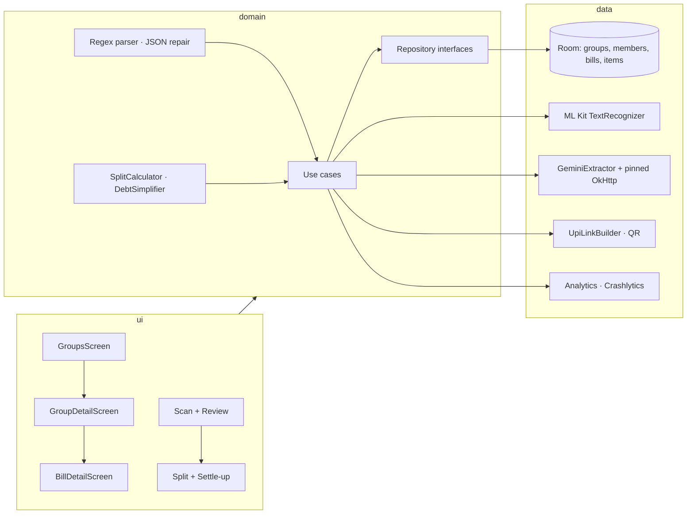

# SplitSmart — AI bill splitter for Android

Photograph a restaurant receipt, let on-device OCR and Gemini turn it into line items, split it paise-exactly between
friends, and settle up with one-tap UPI links. Offline-first (Room), Kotlin, Jetpack Compose, Hilt.

> Build status: feature 1 of 7 (groups, members, bill history). This README grows with every feature.

## Features
| # | Feature | Status |
|---|---|---|
| 1 | Groups and members (Room), offline-first, bill history | done |
| 2 | Receipt scanning: CameraX capture + gallery import → ML Kit on-device text recognition | planned |
| 3 | LLM extraction: Gemini over OkHttp with SSL pinning, strict JSON, validate + repair, editable review, regex fallback | planned |
| 4 | Split calculator: equal / by item / by share, proportional tax + tip, paise-exact remainders, who-owes-whom simplification | planned |
| 5 | One-tap UPI settle-up links (`upi://pay` per debt) + share as text / QR | planned |
| 6 | Firebase Crashlytics + Analytics: scan / parse success, splits created, settle-up taps, custom keys, non-fatals | planned |
| 7 | Performance: Baseline Profile + Macrobenchmark modules, LeakCanary, StrictMode, work off the main thread | planned |

## Screenshots
_Placeholder: screenshots will be added after a run on a device (groups list, group detail, bill detail)._

## Tech stack
Kotlin 2.4 · Jetpack Compose + Material 3 · Navigation Compose (type-safe routes) · Hilt (KSP) · Room 2.8 (exported schemas) ·
Kotlin coroutines + Flow · kotlinx.serialization · OkHttp 5 · CameraX · ML Kit Text Recognition · ZXing · Firebase (Analytics, Crashlytics) ·
JUnit 4, Truth, MockK, Turbine, Robolectric, Compose UI test, MockWebServer, Kover · AGP 9.5 (built-in Kotlin), Gradle 9.6, compileSdk 37, minSdk 26.

## Architecture
MVVM + Clean Architecture: `ui` (Compose + ViewModels, one `StateFlow<UiState>` each) → `domain` (models, use cases, pure
parsers and split math) ← `data` (Room, OCR, LLM client, UPI, analytics). Money is always `Long` paise. Dispatchers and
`java.time.Clock` are injected. Every external SDK sits behind an interface with a fake for JVM tests.



## How to run
1. Clone and open in Android Studio (AGP 9.5, JDK 17 toolchain).
2. `local.properties`:
   ```properties
   sdk.dir=/path/to/Android/Sdk
   LLM_API_KEY=your-gemini-api-key        # optional; without it the app shows a "key missing" state and uses the on-device parser
   ```
   The key is read into `BuildConfig.LLM_API_KEY` at build time (quotes/whitespace stripped) and never logged.
   Like any `BuildConfig` constant it can be extracted from the APK; for a store release move the call behind your own backend.
3. Firebase (optional): put `app/google-services.json` in place. The Google Services and Crashlytics Gradle plugins are
   applied only when that file exists, so a clean clone without Firebase still builds.
4. `./gradlew assembleDebug` and install `app/build/outputs/apk/debug/app-debug.apk`.

## Tests
```bash
./gradlew testDebugUnitTest            # unit + integration (Robolectric, Compose, Room in-memory, Hilt)
./gradlew koverVerifyDebug koverLogDebug  # ≥ 80 % line coverage on domain + data (enforced)
./gradlew stressTest                   # load / stress simulations (excluded from the normal suite)
./gradlew lintDebug assembleDebug      # part of the pre-commit gate
```
| Suite | Count | Notes |
|---|---|---|
| Unit | 38 | money, validators, models, use cases, ViewModels |
| Integration | 11 | Room DAO + repository, Room + ViewModel + Compose flows, Hilt `MainActivity` navigation |
| Stress | 2 | 100k bills in Room; 1,000 concurrent writes |
| Coverage (domain + data) | 96.9 % line | `koverVerify` fails the build below 80 % |

## Security highlights
- Strict validators for names (no control / bidi-override characters, 60 chars) and UPI IDs (ASCII `user@handle` only,
  so nothing can be smuggled into a `upi://pay` link later).
- Money parsing rejects negatives, >2 decimals, exponents, non-ASCII digits and anything above ₹1 crore; all amounts are `Long` paise.
- Domain models enforce invariants in `init` (quantities, non-negative amounts, `qty × unit == total`, ≤ 200 items).
- Double-tap guards on every create action; dialog drafts survive process death via `SavedStateHandle`.
- `allowBackup=false`, data extraction rules exclude everything, no cleartext traffic, only the launcher activity is exported.
- Full log: [`docs/SECURITY_REVIEW.md`](docs/SECURITY_REVIEW.md).

## Load-test highlights
- 100,000 bills + 100,000 items inserted in 1.4 s (~72k rows/s); a 1,000-bill group history loads in 73 ms; paged query 5 ms.
- 1,000 concurrent member + bill writes complete in 0.7 s with no lost rows.
- Full log: [`docs/LOAD_TEST_REPORT.md`](docs/LOAD_TEST_REPORT.md).

## Docs
[`docs/PLAN.md`](docs/PLAN.md) · [`docs/DECISIONS.md`](docs/DECISIONS.md) · [`docs/SECURITY_REVIEW.md`](docs/SECURITY_REVIEW.md) · [`docs/LOAD_TEST_REPORT.md`](docs/LOAD_TEST_REPORT.md)

## Disclaimer
Gemini extraction is a real network call to Google's API with your own key. UPI settle-up links open real UPI apps on the
phone; test with tiny amounts to your own VPA. No backend of its own: everything is on-device plus the Gemini API.
