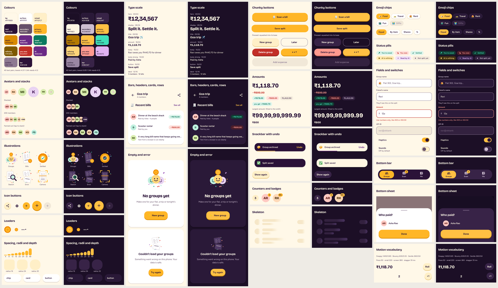
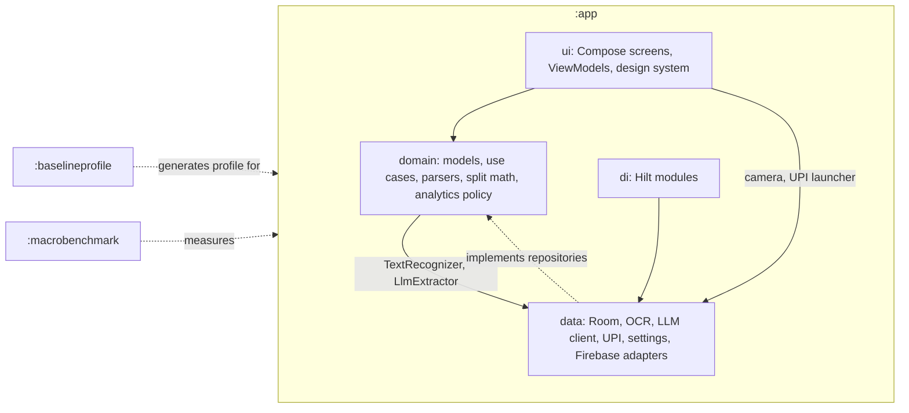
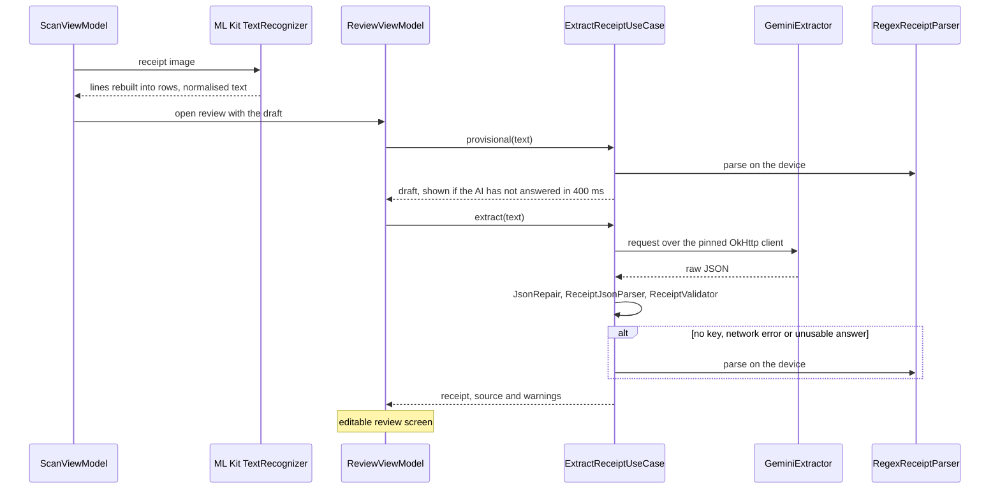
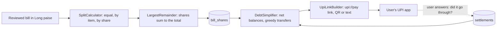

# SplitSmart

[](gradle/libs.versions.toml)
[](app/build.gradle.kts)
[](gradle/libs.versions.toml)

SplitSmart is an Android bill splitter built with Kotlin, Jetpack Compose, Hilt and Room. Photograph a receipt and
ML Kit reads it on the device; Gemini turns the text into JSON line items over a certificate-pinned OkHttp client; the
result is repaired, validated and shown for editing; the bill is split to the exact paisa, debts are simplified, and each
debt gets a UPI settle-up link or QR code.

Without a Gemini API key, a built-in regex parser reads the receipt on the device instead. SplitSmart never moves money:
Pay opens the user's own UPI app, and a settlement is recorded only when the user answers "Did it go through?" with yes,
never from the UPI app's reply.

<p align="center">
  
</p>

## Contents

[Features](#features) · [Architecture](#architecture) · [Tech stack](#tech-stack) ·
[Project structure](#project-structure) · [Getting started](#getting-started) · [Testing](#testing) ·
[Performance](#performance) · [Security](#security) · [Documentation](#documentation) · [Disclaimer](#disclaimer) ·
[License](#license)

## Features

- **Groups and history**: groups, members and bills stored offline in Room, with a per-group timeline and spending
  insights.
- **Receipt scanning**: CameraX capture with live text outlines, or a gallery import, read by ML Kit text recognition on
  the device.
- **AI extraction**: Gemini returns strict JSON for items, tax, tip and total; the answer is repaired, parsed and
  validated, and every fix is shown as a warning on an editable review screen.
- **Offline fallback**: the on-device parser's draft appears while the AI call is in flight, and takes over when there is
  no key, no network or a failed call.
- **Split calculator**: equally, by item or by share and percentage, with tax and tip allocated proportionally and an
  adjustment line for discounts and round-off.
- **Debt simplification**: balances are netted per group and reduced to at most n − 1 transfers.
- **UPI settle-up**: a `upi://pay` link per debt, shared as text or a QR code; payments made another way can be recorded
  too.
- **Analytics and crash reporting**: optional Firebase Analytics and Crashlytics behind interfaces, with a policy that
  rejects personal data.

## Architecture

SplitSmart is a single-activity Compose app organised as MVVM over `ui`, `domain` and `data` packages in one `:app`
module. ViewModels call use cases and repository interfaces from `domain`; `data` implements the repositories with Room.
Use cases reach OCR and the LLM through interfaces in `data` (`TextRecognizer`, `LlmExtractor`), and ViewModels reach the
camera and the UPI launcher the same way, so they can be replaced by fakes on the JVM. Hilt modules in `di` bind the implementations. Every
ViewModel exposes one `StateFlow<UiState>`; dispatchers and `java.time.Clock` are injected; money is always `Long` paise.



### Receipt pipeline



The request asks for `responseMimeType: application/json` with a response schema, at temperature 0, and the key travels
in the `x-goog-api-key` header. `GeminiExtractor` tries `gemini-3.1-flash-lite` first, falls back to the next model on a
404, and retries transport failures with full-jitter backoff that honours `Retry-After`.

### Split, simplify, settle



### Data

Room database version 5 with exported schemas in `app/schemas` and AutoMigrations 1 → 2 → 3 → 4 → 5. Tables:
`split_groups`, `group_members`, `bills`, `bill_items`, `bill_shares`, `receipt_drafts` and `settlements`. Migration tests
build each older exported schema and open it through the real migrations. Settings and the cached model name live in
DataStore.

### Design decisions

- **The model's answer is untrusted input.** It is repaired, parsed and range-checked; the validator never invents data,
  and every repair is shown to the user.
- **The network never blocks the review.** The on-device draft is shown while Gemini works; the AI result replaces it, or
  is offered if the user has already edited.
- **Pins on intermediates and roots.** Google's leaf certificates rotate every few weeks, so `GeminiPins` pins the
  intermediates of both Google chains as primary and their roots as backup. A pin failure falls back to the on-device
  parser.
- **Exact money.** Amounts are `Long` paise and every split uses the largest-remainder method, so shares always sum to the
  printed total and nobody is more than one paisa from their ideal share.
- **A settlement is a user-confirmed record.** The UPI link is started without asking for a result; a settlement counts in
  every balance like a bill in reverse, and only the user's "Yes, mark as paid" creates one.

More in [`docs/DECISIONS.md`](docs/DECISIONS.md).

## Tech stack

| Library | Version | Purpose |
|---|---|---|
| Kotlin, kotlinx.coroutines | 2.4.21, 1.11.0 | Language, structured concurrency and Flow |
| Jetpack Compose BOM, Material 3 | 2026.09.00 | UI toolkit |
| Navigation Compose, kotlinx.serialization | 2.10.2, 1.12.0 | Type-safe routes; Gemini JSON and saved split config |
| Hilt (KSP) | 2.60.1 | Dependency injection |
| Room | 2.8.5 | Groups, bills, splits, drafts and settlements |
| DataStore Preferences | 1.3.0 | Settings, onboarding flag and cached model name |
| CameraX, camera-mlkit-vision | 1.6.2 | Receipt capture and live text outlines |
| ML Kit Text Recognition | 16.0.1 | On-device OCR |
| OkHttp | 5.5.1 | Gemini client with certificate pinning |
| zxing core | 3.5.4 | Settle-up QR codes |
| Firebase BOM (Analytics, Crashlytics) | 35.1.0 | Optional telemetry, applied only with `google-services.json` |
| Macrobenchmark, Baseline Profile | 1.5.0 | Startup, scroll and journey benchmarks, profile generation |

Tests use JUnit 4, Truth, MockK, Turbine, Robolectric 4.17, MockWebServer and okhttp-tls, Roborazzi 1.78.0 and Kover
0.9.11. LeakCanary 2.14 runs in debug builds only. The build uses AGP 9.5.0 with built-in Kotlin and Gradle 9.6.0.

## Project structure

```text
SplitSmart/
├── app/
│   ├── schemas/               exported Room schemas, versions 1 to 5
│   └── src/
│       ├── main/kotlin/com/darshan/splitsmart/
│       │   ├── core/          Money, backoff policy, dispatchers, StrictMode setup
│       │   ├── domain/        models, use cases, parsers, split math, analytics policy
│       │   ├── data/          local (Room), ocr, llm, upi, settings, analytics
│       │   ├── di/            Hilt modules
│       │   └── ui/            one package per screen, plus designsystem/ and navigation/
│       ├── debug/             design-system catalog
│       ├── benchmark/         seed-data receiver for benchmark builds
│       └── test/              unit, integration, stress and realapi; screenshots/ holds baselines
├── baselineprofile/           Baseline Profile generator
├── macrobenchmark/            startup, scroll and journey benchmarks
├── scripts/                   token audit, catalog image and benchmark scripts
└── docs/                      design notes, reviews and reports
```

## Getting started

### Requirements

- JDK 17 or newer (the build uses a JDK 17 toolchain)
- An Android Studio release that supports AGP 9.5, or the Gradle wrapper on its own
- Android SDK platform 37 (compileSdk and targetSdk 37); the app runs on API 26 and above

### API keys

You need to supply API keys for the services the app uses. Both are optional, and a clean clone builds and runs without
them.

1. **Gemini.** Add the key to `local.properties` in the project root (gitignored):
   ```properties
   sdk.dir=/path/to/Android/sdk
   LLM_API_KEY=<your-gemini-api-key>
   ```
   The build reads it into `BuildConfig.LLM_API_KEY` and the app never logs it. Without a key, AI reading is off and the
   built-in parser reads every receipt on the device; the review screen and Me → AI receipt reading say so. Like any
   `BuildConfig` value, the key can be extracted from the APK: a store release should call Gemini through its own backend.
2. **Firebase.** Put your `google-services.json` at `app/google-services.json` (gitignored). The Google Services and
   Crashlytics plugins are applied only when the file exists, and `BuildConfig.FIREBASE_CONFIGURED` switches the real
   trackers on; otherwise analytics and crash reporting are no-ops.

### Build and run

```bash
git clone https://github.com/Darshan-05032003/SplitSmart.git
cd SplitSmart
./gradlew assembleDebug      # debug APK
./gradlew installDebug       # installs on every connected device or emulator
```

> **Real UPI apps.** Settle-up links open real UPI apps and real money can move from there. SplitSmart cannot see the
> outcome; test with ₹1 to your own UPI ID.

## Testing

All tests run on the JVM, mostly against hand-written fakes (`FakeLlmExtractor`, `FakeReceiptCamera`, fake repositories,
a recording analytics tracker that enforces the PII policy) rather than mocks. Room, migrations, Compose screens and Hilt
wiring run under Robolectric. `GeminiExtractor` is tested against MockWebServer for 4xx, 401, 429 with `Retry-After`, 5xx,
timeouts, dropped sockets and malformed bodies, and `PinningTest` proves on a real TLS handshake that a wrong pin is
rejected. Flows are tested with Turbine on virtual time, and Roborazzi screenshot tests cover design-system components and
screens in both themes, at 1.3× text and with reduced motion. A stress suite and a single real Gemini call run separately.

```bash
./gradlew testDebugUnitTest                    # unit and Robolectric integration tests
./gradlew verifyRoborazziDebug                 # same run, comparing screenshots with the committed baselines
./gradlew recordRoborazziDebug --tests '*SettleUpScreenshotTest*'   # re-record one class after an intended change
./gradlew stressTest                           # load and stress simulations, excluded from the normal run
./gradlew realApiTest                          # one real Gemini call through the pinned client; needs LLM_API_KEY
./gradlew koverLogDebug koverVerifyDebug       # domain + data line coverage, rule >= 80 %
./gradlew lintDebug
python3 scripts/token_audit.py                 # raw colours, dp, sp or durations in screen code
```

Latest run: 923 unit and integration tests (843 unit, including 190 screenshot tests, and 80 integration) and 58 stress
tests, all passing. Device-only classes (CameraX, ML Kit, the UPI app chooser) compile and pass lint but are not exercised
on the JVM.

## Performance

- **Baseline Profile**: `:baselineprofile` runs a whole first-evening journey (group, members, a bill, split, settle,
  history); the generated profile ships in `app/src/main/baseline-prof.txt` (its startup effect is not measured yet).
- **Macrobenchmark**: `:macrobenchmark` has `StartupBenchmark`, `ScrollBenchmark` and a `JourneyBenchmark` over
  scan → review → split → settle → history, against a release-like `benchmark` build type.
- **Main thread and stability**: OCR, Gemini and persistence run on injected dispatchers; StrictMode is on in debug
  builds; `app/compose_stability.conf` marks `java.time` types and `DateTimeFormatter` stable.

On a software-rendered emulator (2 GB guest; `am start -W` over 4 cold starts, `dumpsys gfxinfo` over 2 fling rounds per
screen) median cold start went from 929 ms before the redesign to 748 ms after, while a group's bill list got slower to
fling (P90 frame time 32 ms to 39 ms). These are small emulator samples, not phone figures; method, raw numbers and what
was not run are in [`docs/LOAD_TEST_REPORT.md`](docs/LOAD_TEST_REPORT.md).

## Security

- **Certificate pinning**: the Gemini client pins Google's intermediates (primary) and roots (backup) for
  `generativelanguage.googleapis.com`; no redirects, and 4xx or malformed answers are never retried.
- **Key handling**: the API key is sent in a header, never in a URL, and is never logged.
- **Telemetry without personal data**: `AnalyticsPolicy` rejects event keys containing words such as name, vpa, amount or
  phone, and values containing `@` or ten or more digits; Crashlytics log lines are scrubbed.
- **Tapjacking**: settle-up drops touches that arrive through another app's window, and every action that opens or
  records a payment also drops partly obscured touches.
- **Input sanitising**: the launch intent is replaced by a plain launcher intent (`LaunchIntentPolicy`); names, notes and
  OCR text are stripped of control and bidi characters; UPI links are percent-encoded and re-parsed before launch.
- **Storage**: receipt images live in a private cache behind a non-exported FileProvider with a path-traversal guard;
  `allowBackup` is off and cleartext traffic is disabled.

Threats, findings and fixes per feature: [`docs/SECURITY_REVIEW.md`](docs/SECURITY_REVIEW.md).

## Documentation

- [`docs/PLAN.md`](docs/PLAN.md): build plan, package structure, test and stress plan
- [`docs/DECISIONS.md`](docs/DECISIONS.md): design decisions and compromises, per feature and per screen
- [`docs/SECURITY_REVIEW.md`](docs/SECURITY_REVIEW.md): per-feature threats, findings and fixes
- [`docs/LOAD_TEST_REPORT.md`](docs/LOAD_TEST_REPORT.md): stress scenarios, benchmark method and results
- [`docs/DESIGN_SYSTEM.md`](docs/DESIGN_SYSTEM.md): tokens, components, motion and accessibility rules
- [`docs/DESIGN_DIRECTION.md`](docs/DESIGN_DIRECTION.md): the visual direction and the alternatives considered
- [`docs/UI_AUDIT.md`](docs/UI_AUDIT.md): the audit the UI overhaul started from
- [`docs/CREDITS.md`](docs/CREDITS.md): fonts and licences

Screens: [`docs/screenshots`](docs/screenshots) (emulator captures from before the redesign) and the current screenshot
baselines in [`app/src/test/screenshots`](app/src/test/screenshots). Short emulator recordings of the redesigned flows:
[`docs/media`](docs/media).

## Disclaimer

SplitSmart is a portfolio project. It is not a payment app and is not affiliated with Google, NPCI, any bank or any UPI
app. With a key, receipt text is sent to Google's Gemini API under your own account; there is no SplitSmart backend.
All names in the sample data are invented.

## License

Portfolio project by Darshan Sonawane. All rights reserved unless a license file says otherwise.
Bundled fonts (Bricolage Grotesque, Figtree) are under the SIL Open Font License 1.1; see
[`docs/CREDITS.md`](docs/CREDITS.md).
