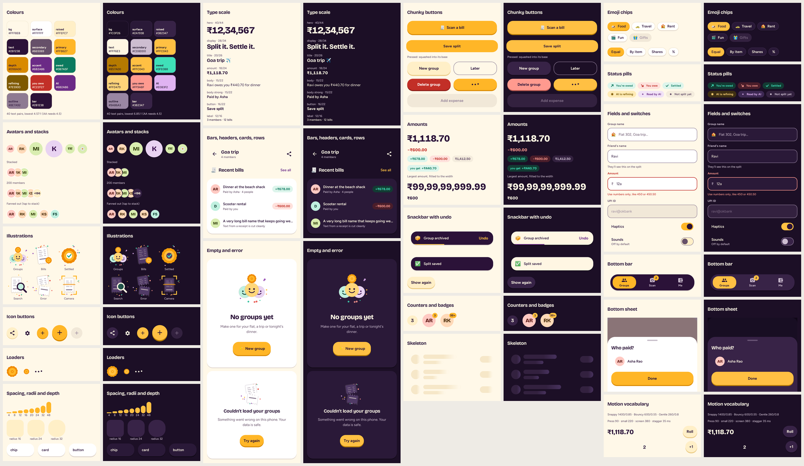

# SplitSmart design system: Marigold Mela

A festival with friends: marigold on warm cream, deep aubergine ink, mint for money coming in, chilli for money going out. Chunky rounded shapes that squash under your thumb, bouncy-but-quick springs, emoji as accents, and celebration kept for real achievements. Direction and alternatives: [`DESIGN_DIRECTION.md`](DESIGN_DIRECTION.md).



The image is built from the screenshot-test baselines in `app/src/test/screenshots/` (`ds_*`). On a debug build the live catalog opens with:

```
adb shell am start -n com.darshan.splitsmart/.ui.designsystem.catalog.DesignCatalogActivity
```

It is in the `debug` source set and debug manifest only. Release builds contain no catalog class or manifest entry (checked in the merged release manifest and dex, and by `CatalogReleaseIsolationTest`).

## Where things live

| Path (`app/src/main/kotlin/com/darshan/splitsmart/ui/`) | What |
|---|---|
| `designsystem/tokens/MarigoldColors.kt` | `MarigoldLight`, `MarigoldDark`, `Tone`, `AvatarTone`, contrast helpers and the list of every text pair |
| `designsystem/tokens/SplitSmartType.kt` | `BricolageDisplay`, `BricolageText`, `Figtree`, the `SplitSmartType` scale |
| `designsystem/tokens/Dimens.kt` | `Spacing`, `Radii`, `Depth`, `Strokes`, `Sizes` |
| `designsystem/motion/` | `MotionDurations`, `MotionEasing`, `MotionSprings`, `MotionToken`, `SplitSmartMotion`, `resolveMotionLevel` |
| `designsystem/effects/` | `Haptics`/`HapticEvent`, `UiSound`, `UiEffect` + `UiEffectChannel` + `CollectUiEffects`, `UiPreferences` |
| `designsystem/modifiers/` | press feedback with squash and stretch, shake, staggered pop-in |
| `designsystem/components/` | the components below, and their pure logic in `ComponentLogic.kt` and `SnackbarState.kt` |
| `theme/Theme.kt` | `SplitSmartTheme`: the one theme entry |

Read theme tokens with `SplitSmartTheme.colors`, `.type`, `.motion` and `.haptics`; static tokens are plain objects (`Spacing.md`, `Radii.mediumShape`, `Sizes.touchTarget`).

## Tokens

### Colour
| Token | Light | Dark | Use |
|---|---|---|---|
| `bg` | `#FFF8E8` | `#1C0F26` | page |
| `surface` | `#FFFFFF` | `#2A1938` | cards, rows, fields |
| `raised` | `#FFEFC7` | `#382347` | secondary buttons, tinted surfaces |
| `text` / `textSecondary` | `#2B1238` / `#665069` | `#FFF6E3` / `#CDBDD0` | ink |
| `primary` / `onPrimary` | `#FFB627` / `#2B1238` | `#FFC043` / `#2B1238` | the one main action, selection |
| `primaryDepth` | `#D98A00` | `#B57A00` | the base a primary button presses into |
| `accent` | `#6B2A86` | `#FFC043` | focus rings, text actions |
| `success` (owed) | `#0B7A5F` on `#DDF5EC` | `#3FE0B8` on `#123B33` | money to you, settled |
| `pending` (refining) | `#7E5900` on `#FFEBB5` | `#FFD479` on `#3E2F12` | AI still working |
| `failed` (you owe) | `#C22F27` on `#FFE1DC` | `#FF9A8F` on `#4A1D2A` | money you owe, errors |
| `info` (AI) | `#6B2A86` on `#F1E2F7` | `#E0B3F2` on `#3D2853` | made by AI |
| `bar` | `#2B1238` | `#382347` | the floating bottom bar |

All 40 text pairs per theme pass WCAG AA (lowest 4.57:1 light, 6.85:1 dark); control boundaries pass 3:1. `ContrastTest` computes every ratio, so a colour change that breaks contrast fails the build. Avatars use six pastel colourways that stay the same in both themes; a person's colour is stable per name.

### Type
Bricolage Grotesque for headlines and numbers, Figtree for everything else and for the sign of every amount. Both have the ₹ glyph.

| Style | Font | Size/line |
|---|---|---|
| `hero` | Bricolage ExtraBold, tabular | 40/44 |
| `display` | Bricolage ExtraBold | 28/34 |
| `title` | Bricolage Bold | 20/26 |
| `amount` / `amountSmall` | Bricolage (text optical size), tabular | 18/24, 14/18 |
| `body` / `bodyStrong` | Figtree | 15/22 |
| `button` | Figtree Bold | 16/22 |
| `label` / `labelStrong` | Figtree | 12/16 |

### Shape, space, depth
- Spacing on the 4dp grid: 4, 8, 12, 16, 20, 24, 32, 40, 48, 64; screen gutter 16.
- Radii 16 (fields, snackbars), 24 (buttons, cards), 32 (sheets, hero cards, bottom bar), plus pills and circles.
- Depth is a solid offset, not a blur: chip 2, card 3, button 4, FAB 5 dp. Pressing closes the gap.
- Touch targets are at least 48dp everywhere.

## Motion
| Spring | Stiffness / damping | Use |
|---|---|---|
| Snappy | 1400 / 0.85 | finger down, small flips |
| Bouncy | 600 / 0.55 | release, arrivals, bumps, the blob |
| Gentle | 260 / 0.8 | big things coming to rest |

Durations: press 90, micro 120, small 220, screen 380 (fast 340, slow 460) ms; stagger 35 ms per item, capped at 280; digit ripple 18 ms per column. Easing curves are emphasized, emphasized decelerate/accelerate and standard; there is no linear curve.

Components name a `MotionToken` and `SplitSmartMotion` decides how it plays:

| Role | Tokens | Full motion | Reduced motion |
|---|---|---|---|
| Feedback | Press, Release | springs | 90 ms tween, no overshoot |
| Essential | Snap, Bounce, Bump, Settle, Micro, Small, Screen, ScreenExit, Shake | as designed | 150 ms fade |
| Decorative | Ambient, Shimmer, Celebrate | as designed | off |

Reduced motion is on when the in-app setting is on or the system animator scale is 0 (a broken reading counts as 0). It changes how a step looks, never whether it happens: the undo window, confirmations and locks are the same.

Rules for screens:
- Press feedback starts within 100 ms (raw pointer events, not `clickable`'s delayed press).
- Read animated values in `graphicsLayer`, `drawBehind` or `drawWithCache`, not in composition.
- Decorative motion never blocks input. Confetti only for real achievements (settled, all square).
- No raw colours, dp/sp, durations or easing in screen code: `scripts/token_audit.py` and `TokenAuditTest` enforce it.

## Haptics
| Event | Moment |
|---|---|
| Tick | bottom bar tab, stack fanning out, chip or switch toggled |
| Light | an accepted button tap, Undo, an item gulped by an avatar |
| Confirm | a debt settled, a split saved |
| Reject | a field error appears, something refused |
| Heavy | deleting a group, the shutter |

`Haptics` maps them to `HapticFeedbackConstants` (CONFIRM and REJECT from API 30, older equivalents below), needs no permission, and follows both the phone's touch-feedback setting and the in-app Haptics switch. ViewModels send `UiEffect.Haptic(...)` through a `UiEffectChannel`; screens collect it with `CollectUiEffects`.

## Components
| Need | Component | Notes |
|---|---|---|
| Main action | `ChunkyButton(text, onClick, style = Primary)` | one Primary per screen; `loading` swaps the label for dots and ignores taps; one action per 500 ms; light haptic |
| Other actions | `ChunkyButton(style = Secondary/Ghost/Danger)`, `ChunkyIconButton`, `TextAction` | icon buttons need a `contentDescription`; `IconButtonSize.Fab` for the FAB; `iconModifier` turns or scales the glyph alone (the FAB's plus becoming a cross) |
| People | `MemberAvatar(name)`, `AvatarStack(names)` | stack fans out on tap; 200 members show four faces and "+196"; one TalkBack sentence |
| Money | `AmountText`, `AmountPill(paise, AmountTone)`, `RollingAmount(paise)` | Long paise, ₹, Indian grouping, clamps at ₹99,99,99,999.99, shrinks to fit; "minus" spelled out for TalkBack |
| Counts | `BumpCounter(count)`, `CountBadge(count)` | bump on change, "99+" past 99 |
| Choices | `EmojiChip(label, selected, onClick, emoji, exclusive)`, `SsSwitchRow` | `exclusive` = radio (split mode), otherwise checkbox |
| Status | `StatusPill(StatusKind, label)` | Owed, Owe, Settled, Refining, Ai, Neutral; `animate = false` in long lists |
| Input | `SsTextField(value, onValueChange, label, error)` | focus ring and glow; error wiggles once with a reject haptic |
| Structure | `SsTopBar`, `SsSectionHeader`, `ChunkyCard`, `SsListRow` | outside text is cleaned with `DisplayText.safe`; `SsSectionHeader(actionModifier)` tags or relabels its action |
| Empty / error / loading | `EmptyState`, `ErrorState`, `Illustration`, `SkeletonList`, `BrandLoader`, `LoadingDots` | illustrations are code-drawn; no grey spinners |
| Overlays | `SsBottomSheet(visible, onDismissRequest, dismissible)`, `SsSnackbarHost(state)` | sheet is in-window and last in a full-screen `Box`; on a tab screen call `HideShellBarWhile(open)` so the floating bar steps aside; snackbar `show()` suspends and returns `Undo`/`TimedOut`/`Dismissed`/`Replaced` |
| Navigation | `SsBottomBar(items, selectedIndex, onSelect, onReselect)` | marigold blob stretches as it travels; tick haptic |
| Delight | `ConfettiBurst(playKey)` | achievements only; off under reduced motion |

## Testing
- Pure logic (formatting, odometer glyphs, stack layout, sheet physics, blob shape, confetti physics, click guard, snackbar state) has JVM unit tests.
- Compose tests run on Robolectric with a paused clock: rapid taps give one action, press feedback within 100 ms, the stretch on release, no per-frame recomposition, 1.3× text inside its bounds, reduced motion, TalkBack labels and states.
- Roborazzi baselines: every catalog section in light and dark, at 1.3× and with reduced motion where it matters, plus mid-animation frames. `./gradlew recordRoborazziDebug --tests '<Class>'` after an intended change, `verifyRoborazziDebug` in the gate.

Fonts and all other credits: [`CREDITS.md`](CREDITS.md).
