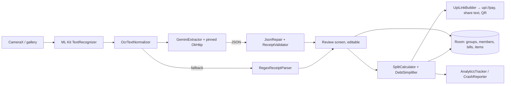

# SplitSmart build plan

SplitSmart is an AI bill splitter: photograph a receipt, OCR it on-device with ML Kit, let Gemini turn the text into
strict JSON line items (with a regex fallback), split the bill paise-exactly, and settle up over UPI links.
This plan is written before the first feature and is the contract the build follows. Status lives in the root
`PROGRESS.md`; decisions in `docs/DECISIONS.md`.

## Features, in build order (each = tests first → code → security review → load test → one commit → push)
| # | Feature | Resume claim |
|---|---|---|
| 1 | Groups, members, bill history (Room, offline-first) | "Groups and members (Room), offline-first, plus bill history" |
| 2 | Receipt scanning: CameraX capture + gallery import → ML Kit on-device text recognition | "Receipt scanning: CameraX capture + gallery import, then ML Kit on-device text recognition" |
| 3 | LLM extraction: Gemini over OkHttp with SSL pinning, strict JSON, validate/repair, editable review, regex fallback | "LLM extraction … OkHttp with SSL pinning … strict JSON … validate and repair … editable review screen. Fallback: on-device regex parser" |
| 4 | Split calculator: equal / by item / by share, proportional tax+tip, paise-exact remainders, debt simplification | "Split calculator …" |
| 5 | One-tap UPI settle-up links + share as text / QR | "One-tap UPI settle-up links (`upi://pay` per debt, plus share as text/QR)" |
| 6 | Firebase Crashlytics + Analytics behind interfaces, success metrics, custom keys, non-fatals | "Firebase Crashlytics + Analytics: track success metrics …" |
| 7 | Performance: baselineprofile + macrobenchmark modules, LeakCanary, StrictMode, work off main thread | "Performance …" |

## Module / package structure
```
SplitSmart/
├── app/                         com.darshan.splitsmart
│   ├── core/                    DispatcherProvider, Money (Long paise), Ids
│   ├── domain/
│   │   ├── model/               Group, Member, Bill, BillItem, ReceiptDraft, SplitMode, SplitResult, Debt, Transfer
│   │   ├── repository/          GroupRepository, BillRepository (interfaces)
│   │   ├── usecase/             CreateGroup, AddMember, SaveBill, ExtractReceipt, ComputeSplit, BuildSettleUp …
│   │   ├── parser/              RegexReceiptParser, JsonRepair, ReceiptValidator, OcrTextNormalizer (pure Kotlin)
│   │   └── split/               SplitCalculator, LargestRemainder, DebtSimplifier (pure Kotlin)
│   ├── data/
│   │   ├── local/               Room: SplitSmartDatabase, entities, DAOs, mappers (schemas exported to app/schemas)
│   │   ├── repository/          GroupRepositoryImpl, BillRepositoryImpl
│   │   ├── ocr/                 TextRecognizer (+MlKit impl), ReceiptImageStore (FileProvider, receipts/ cache dir), camera/gallery interfaces
│   │   ├── llm/                 LlmExtractor, GeminiExtractor (OkHttp), GeminiPins/CertificatePinner factory, DTOs, LlmException
│   │   ├── upi/                 UpiLinkBuilder, QrCodeGenerator (zxing), SettleUpLauncher interface + Android impl
│   │   └── analytics/           AnalyticsTracker / CrashReporter interfaces, Firebase + NoOp/Recording impls
│   ├── di/                      Hilt modules (App, Database, Repository, Ocr, Llm, Upi, Analytics)
│   └── ui/                      Compose screens + ViewModels (groups, group detail, bills, scan, review, split, settle), navigation, components, theme
├── baselineprofile/             com.android.test + androidx.baselineprofile (generator, uiautomator)
└── macrobenchmark/              com.android.test (startup + scroll benchmarks)
```

## Architecture
MVVM + Clean Architecture. `ui` → `domain` ← `data`. Each ViewModel exposes a single `StateFlow<UiState>` (sealed
Loading / Empty / Error / Content) and one-off events via a `Channel`. Hilt (KSP) wires everything; dispatchers and
`java.time.Clock` are injected. Money is always `Long` paise. Every external SDK (CameraX, ML Kit, OkHttp/Gemini,
UPI apps, zxing, Firebase) sits behind an interface with a fake for JVM tests. Offline-first: Room is the single
source of truth; the LLM is an optional enhancer with an on-device fallback.



## Test plan
- Unit (JUnit4 + Truth + MockK + Turbine + coroutines-test): models, use cases, parsers, JSON repair, split math,
  debt simplifier, UPI builder, ViewModels (with `TestDispatcherProvider` and `SavedStateHandle`).
- Integration (Robolectric `@Config(sdk = [35])`): Room in-memory DAO + repository + ViewModel, Compose UI flows
  (`createComposeRule`), Hilt `MainActivity` test, MockWebServer for every Gemini path (success, 4xx, 401, 429 with
  Retry-After, 5xx, timeout, malformed JSON), CertificatePinner rejection with a wrong pin, FileProvider path traversal.
- Stress (`./gradlew stressTest`, package `com.darshan.splitsmart.stress`, excluded from `testDebugUnitTest`):
  see the table below. Each prints `STRESS [...]` lines with real numbers recorded in `docs/LOAD_TEST_REPORT.md`.
- Coverage: Kover on `domain.*` + `data.*`, `koverVerify` ≥ 80 % line coverage, run with the gate before every commit.
- Device-only (CameraX, ML Kit, Baseline Profile, Macrobenchmark, connectedAndroidTest): compile-only, commands in the
  README, recorded as "not run: no device".

## Stress scenarios per feature
| # | Scenario |
|---|---|
| 1 | 100k bills in Room: insert time, history query time, paged query time; 1,000 concurrent group/member writes |
| 2 | 10,000 synthetic OCR texts through `OcrTextNormalizer`; 1,000 concurrent receipt image files in the store |
| 3 | 10,000 synthetic receipts through `RegexReceiptParser`; 1,000 concurrent `GeminiExtractor` calls against MockWebServer with 429s (backoff must not thunder); 10,000 malformed JSON blobs through `JsonRepair` |
| 4 | Random splits always sum exactly; 1,000 people × 10,000 items; debt simplification on 1,000 members |
| 5 | 10,000 UPI links built + parsed back; hostile VPA / name fuzzing; 1,000 QR renders |
| 6 | 10,000 analytics events through the tracker (no PII, bounded queue); 1,000 non-fatals |
| 7 | Main-thread guard: all heavy paths run on injected dispatchers; LeakCanary / StrictMode compile-only on JVM |

## Gate before every commit
`./gradlew testDebugUnitTest assembleDebug lintDebug koverVerifyDebug`, then the secret/private-file checks, then
`git push origin main`.
